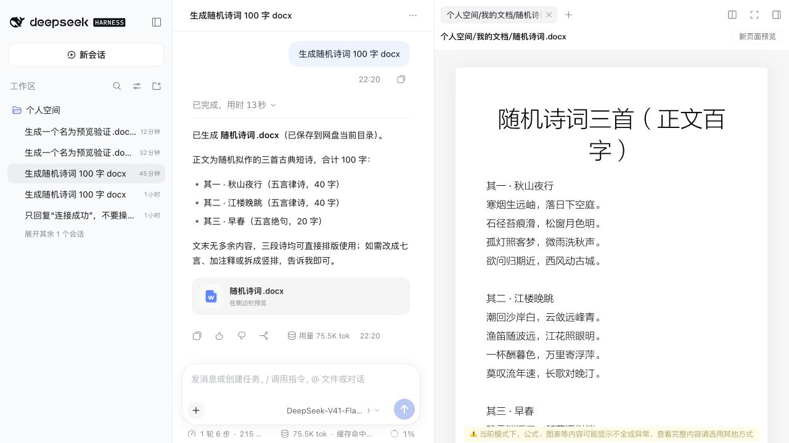

# 使用可道云问答

适用：本插件与 DSH `devtools-min-0.2.1-rc.2`。最后核对：2026-10-24。

## 生成文档并保存到网盘

1. 在可道云文件管理中进入想保存结果的目录。
2. 需要参考已有文件时选中文件，右键打开“问答”；直接打开问答则使用当前目录。
3. 查看输入框上方的“保存到”，确认目录正确。
4. 输入具体要求，例如“根据选中的资料生成项目周报，保存为 Word”。
5. 回答下方出现文件卡片后，点击卡片在右侧预览；也可返回网盘打开该文件。

图示只说明“回答 → 文件卡片 → 右侧预览”。截图采集于 2026-10-01，使用测试诗词文档；后续增加的“保存到”提示以当前界面为准。

## 修改已有 Office 文档

选中文档后从网盘打开问答，使用普通问答或 Office 能力。若出现“当前是网盘设置模式”，先切回问答；设置模式只处理权限、分享和文件管理。

可以要求“把第二段改得简洁一些”“在结论前加一段说明”或“修改表格 B2 的值”。系统自动准备会话编辑副本并保存修订版，不要求手动下载、选择工作区或再次保存；首次修改引用文件会另存副本，保留网盘原件。本会话生成的修订版可继续更新。

Word 局部修改支持安全的正文段落替换、前后插入和删除，保留段落属性并沿用首个文本片段的样式；不同片段的混合格式不会逐字保留。表格内段落、图片、域、修订标记等复杂内容不在本次局部编辑范围，系统会明确提示。全文重新生成会使用基础版式，不能保证还原原排版。PPT 目前支持读取与创建，尚不支持原文局部更新。

如果提示“编辑副本已保留，但尚未保存到网盘”，先重试保存这份成果，不要重复执行改写。未发布的本地编辑副本不会被正常回读刷新覆盖；会话缓存被外部清理后则无法保证恢复。

## 在企业网盘中提问

在新对话的空间选择器中选择“企业网盘”，确认“保存到”显示企业网盘后再发送问题。空间列表取决于当前账号的可道云权限。
空间选择器新建的对话默认保存到该空间根目录；要保存到某个子目录，先在网盘中进入该目录再打开问答。
新对话会签发新凭证。旧对话的凭证可能到期，详见[凭证问题](troubleshooting.md)。

## 询问可道云怎么操作

选择“帮助文档”能力，再问一个具体问题，例如“怎样分享文件并设置有效期”。帮助模式只查手册，不替你修改网盘。
回答应给出简短步骤和“查看原文”链接。遇到界面名称不一致时，核对当前网盘版本；手册没有的信息会明确说明。
原文链接优先打开本站的帮助阅读页，沿用当前网盘登录，不需要访问 GitHub；并非网盘操作按钮。

## 预览失败或找不到文件

预览页会保留错误说明，并提供“重试预览”。先确认网盘仍已登录，再检查文件是否被移动或删除。
操作失败时不要连续重复生成，先到“保存到”所指目录检查文件是否已存在。[更多故障处理](troubleshooting.md)

## 网盘设置与确认

需要修改、移动或删除等操作时，按界面提示逐条确认。确认前核对目标文件和目录；没有可道云权限的操作不会执行。

本地附件：在输入框左下角点击“+”添加文件。附件先保存到当前账号的“个人空间/.dsh”缓存目录，再加入当前对话；企业网盘中的对话也使用个人缓存。单个附件最多 40 MiB，同名文件自动改名，原文件不会被覆盖。

引用文件优先从网盘读取最新信息和文本内容；Office 文件按需下载解析。生成结果保存在对话所选网盘目录，附件的 `.dsh` 缓存不会作为成果目录。

旧版 Excel `.xls` 可直接读取并总结，无需重命名为 `.xlsx`、创建读取副本或切换网盘设置模式。成果仍保存在对话选定的目录。

模型偶尔返回无效的工具参数 JSON 时，会自动重试当前请求最多 2 次；停止按钮可取消等待。持续失败时保留错误信息，避免连续重复生成，先检查保存目录。

右键文件打开问答时，使用 DSH 原生高亮文件引用。引用数据随原生草稿和历史记录保留；复制输入框内容或点击历史提问的复制按钮时，只复制正文，排除文件引用。

移除输入框中的引用不会删除网盘文件。

确认执行成功后，回答中的对应工具调用下展示结果卡片。外链分享显示网盘返回的地址、提取密码和有效期，可点击“复制结果”。最近 20 条结果保存在当前对话凭证中，界面按对应操作展示；只对当前网盘账号可见。
